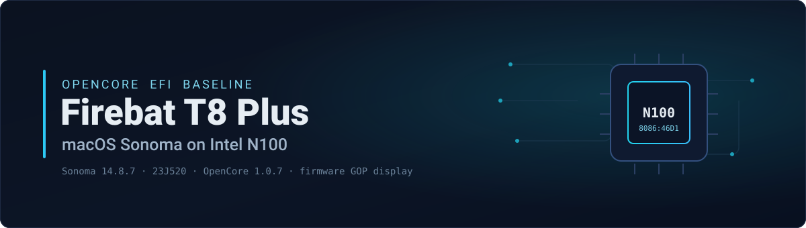

<div align="center">




<br><br>

[English](README.md) · **한국어**

**Firebat T8 Plus** 미니 PC(**Intel N100** / Alder Lake-N)에서 **macOS Sonoma 14.8.7 (23J520)** 을
구동하기 위한, 정제되고 재현 가능한 **OpenCore EFI** 입니다. 안정적인 폴백 베이스라인으로, 펌웨어
**GOP** 프레임버퍼 위에서 부팅과 네트워크가 안정적으로 동작합니다. N100 내장 GPU는 하드웨어
가속되지 **않습니다**.

<br>

-1f6feb?style=flat-square&labelColor=0b1220&logo=apple&logoColor=white)


[**빠른 시작**](#빠른-시작) · [호환성](#하드웨어-호환성) · [제약 사항](docs/Limitations.md) · [설치 가이드](docs/Setup.md)

</div>

---

## 개요

이 저장소는 빌드의 **정제된 설정 계층** 입니다 — OpenCore `config` 템플릿, ACPI SSDT, 구성요소
잠금 파일(lockfile), 설치 도구만 포함합니다. Apple 소프트웨어나 서드파티 바이너리는 **일절
재배포하지 않으며**, OpenCore와 모든 kext는 각 공식 오픈소스 릴리스에서 내려받습니다.

| | |
|---|---|
| **기기** | Firebat T8 Plus 미니 PC |
| **SoC** | Intel **N100** (Alder Lake-N, Xe-LP iGPU `8086:46D1`), 16 GB LPDDR5 |
| **macOS** | Sonoma **14.8.7** · 빌드 **23J520** |
| **부트로더** | OpenCore **1.0.7** |
| **무선** | Intel **AX210** (Wi-Fi + Bluetooth) |
| **유선** | Realtek **RTL8111** 이더넷 |
| **디스플레이** | 펌웨어 **GOP** 프레임버퍼 (가속 없음) |

> **가속된 Mac이 아니라 베이스라인입니다.** GPU 가속, Metal, 하드웨어 비디오 디코딩은 의도적으로
> 여기에 **구현되어 있지 않습니다**. 커스텀 N100 GPU 드라이버 연구는 *별도로 진행 중인* 작업이며 이
> 베이스라인에 **포함되지 않습니다**.

## 하드웨어 호환성

**동작**으로 표시된 항목만 실제 기기에서 런타임으로 확인된 것입니다. GPU 관련 항목은 이 베이스라인에서
의도적으로 **미구현** 상태입니다.

| 기능 | 상태 |
|---|:--|
| macOS Sonoma 23J520 부팅 | ✅ **동작** |
| 3440×1440 펌웨어 GOP 디스플레이 | ✅ **동작** — 가속 없음, Metal 없음 |
| Intel AX210 Wi-Fi | ✅ **동작** — [문서화된 제약](docs/Limitations.md#networking) 있음 |
| Intel AX210 Bluetooth | ✅ **동작** — [문서화된 제약](docs/Limitations.md#networking) 있음 |
| Realtek 이더넷 | ✅ **동작** |
| 오디오 (기본 출력) | ✅ **동작** |
| Intel N100 GPU 가속 | ⛔ **미구현** |
| Metal | ⛔ **미구현** |
| 하드웨어 비디오 디코딩 | ⛔ **미구현** |
| 네이티브 Alder Lake-N 디스플레이 드라이버 | ⛔ **미구현** |
| 절전 / 복귀 (Sleep/Wake) | ⚪ **미검증** |

## 빠른 시작

> 사전 요건: 동작하는 OpenCore 워크플로우와 기본적인 Hackintosh 이해. 모든 구성요소 버전은
> [`components.lock.json`](components.lock.json) 에 고정되어 있습니다.

**1 · 고정된 구성요소 받기** (OpenCore 1.0.7 + kext를 공식 릴리스에서 다운로드 — 저장소에는 아무것도
재배포하지 않음):

```bash
./fetch-efi-components.command
```

**2 · 본인만의 머신 식별자 생성** (타인의 값을 절대 재사용하지 말 것):

- **SMBIOS** — [GenSMBIOS](https://github.com/corpnewt/GenSMBIOS), 모델 `iMacPro1,1`
  (`SystemSerialNumber`, `MLB`, `SystemUUID`, `ROM`).
- **USB 맵** — [USBToolBox](https://github.com/USBToolBox/tool) 로 본인의 `UTBMap.kext` 생성.

**3 · 템플릿에서 config 생성:**

```bash
cp EFI/OC/config.template.plist EFI/OC/config.plist
# PlatformInfo > Generic (본인 SMBIOS) 와 USB 맵 kext 항목을 편집
```

**4 · 검증** (오류 없이 통과해야 함):

```bash
ocvalidate EFI/OC/config.plist
```

**5 · 설치** — `EFI/` 를 USB/ESP FAT32 파티션에 복사하고 펌웨어 부트 메뉴에서 OpenCore를 선택합니다.
**가속되지 않은** 데스크톱이 표시됩니다.

전체 안내: [`docs/Setup.md`](docs/Setup.md) · 알려진 제약: [`docs/Limitations.md`](docs/Limitations.md).

## 저장소 구성

```
.
├─ EFI/                        OpenCore 트리 (config.template.plist + ACPI SSDT; 바이너리 없음)
├─ docs/
│  ├─ Setup.md                 간결한 설치 가이드
│  └─ Limitations.md           동작/미동작 항목과 그 이유
├─ assets/readme/              README 아트워크 원본 (정적 SVG)
├─ components.lock.json        고정된 업스트림 프로젝트 + 정확한 버전
├─ fetch-efi-components.command 잠금 파일을 읽는 다운로더
└─ .githooks/                  식별자 + 템플릿 플레이스홀더 가드
```

## 재현성

[`components.lock.json`](components.lock.json) 은 모든 업스트림 프로젝트와 정확한 버전(OpenCore
1.0.7 및 Acidanthera / OpenIntelWireless / Mieze kext)을 고정합니다. `fetch-efi-components.command`
이 이를 읽어 각 아티팩트를 **공식** 릴리스에서 받아오며, 자동화할 수 없는 항목은 수동 다운로드 안내를
출력합니다. 바이너리는 재현성을 위해 의도적으로 커밋하지 **않습니다**.

## 개인정보 및 식별자

배포되는 `config.template.plist` 에는 **플레이스홀더만** 들어 있습니다(`CHANGEME…`, 0으로 채운
UUID/ROM).

- **본인의** SMBIOS(`SystemSerialNumber`, `MLB`, `SystemUUID`, `ROM`)와 USB 맵을 직접 생성해 보관하세요.
- 실제 식별자를 **절대 커밋하지 마세요**. 저장소의 `.githooks` 가 템플릿 플레이스홀더와 사람 Git
  식별자를 보호합니다.

## 크레딧

오픈소스 Hackintosh 생태계 위에서 구축되었으며, 모두 각 공식 릴리스에서 받아옵니다:

- [OpenCorePkg](https://github.com/acidanthera/OpenCorePkg) 및 Acidanthera kext
- [AirportItlwm / itlwm](https://github.com/OpenIntelWireless/itlwm),
  [IntelBluetoothFirmware](https://github.com/OpenIntelWireless/IntelBluetoothFirmware) (OpenIntelWireless)
- [RealtekRTL8111](https://github.com/Mieze/RTL8111_driver_for_OS_X) (Mieze)
- [USBToolBox](https://github.com/USBToolBox/tool) (USB 매핑) 및 CorpNewt의 [GenSMBIOS](https://github.com/corpnewt/GenSMBIOS)
- [Dortania](https://dortania.github.io/) 가이드 및 사전 빌드된 SSDT

## 범위 및 면책

개인적으로 정제한 설정 베이스라인이며 상호운용성과 교육 목적을 위해 **있는 그대로(as-is)** 제공됩니다.
config 템플릿, ACPI SSDT, 도구만 포함하고 Apple 소프트웨어나 서드파티 바이너리는 포함하지 않습니다.
본인의 SMBIOS, 라이선스 준수, 그리고 비(非)Apple 하드웨어에서 macOS를 구동하는 데 따르는 위험은
사용자 책임입니다. Apple, Intel, Firebat 및 언급된 어떤 업스트림 프로젝트와도 제휴/보증 관계가 없습니다.
