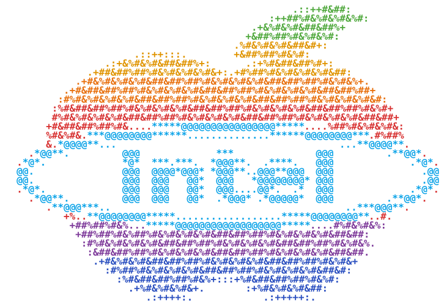

<p align="center">
  <picture>
    <source media="(prefers-color-scheme: dark)" srcset="assets/logo/logo-dark.svg">
    
  </picture>
</p>

<h1 align="center">Firebat T8 Plus</h1>

<p align="center">
  <strong>macOS Sonoma on Intel N100</strong><br>
  <sub>Unofficial community artwork · not affiliated with Apple or Intel</sub>
</p>

<p align="center">
  
  
  
</p>

`English` · [한국어](README.ko.md)   —   [00 Overview](#00--overview) · [01 Compatibility](#01--compatibility) · [02 Quick Start](#02--quick-start) · [03 Hardware](#03--hardware) · [04 Limitations](#04--limitations) · [05 Credits](#05--credits)

> **macOS Sonoma on an Intel N100.** A sanitized, reproducible OpenCore EFI for a **verified,
> unaccelerated** Sonoma baseline. macOS boots and networks reliably on the firmware GOP
> framebuffer, but the N100 iGPU has **no** macOS driver — so there is no Metal and no hardware
> video decode.

---

## 00 / Overview

This repo is the **configuration layer** only: the OpenCore `config` template, ACPI SSDTs, a
pinned component lockfile, and setup tooling. It ships **no** Apple software and **no**
third-party binaries — OpenCore and every kext are fetched from their official releases.

It is a **stable fallback baseline**, deliberately GPU-less. Custom N100 GPU-driver research is
a separate, ongoing effort and is **not** part of this repository.

## 01 / Compatibility

Only **Working** rows are runtime-confirmed on the real machine. Everything GPU-related is
intentionally **not implemented** in this baseline.

| Feature | Status |
|---|:--|
| macOS Sonoma 23J520 boot | Working |
| 3440×1440 firmware GOP display | Working — unaccelerated, no Metal |
| Intel AX210 Wi-Fi | Working — [documented limits](docs/Limitations.md#networking) |
| Intel AX210 Bluetooth | Working — [documented limits](docs/Limitations.md#networking) |
| Realtek Ethernet | Working |
| Audio (basic output) | Working |
| Intel N100 GPU acceleration | Not implemented |
| Metal | Not implemented |
| Hardware video decode | Not implemented |
| Native Alder Lake-N display driver | Not implemented |
| Sleep / wake | Unverified |

## 02 / Quick Start

New to this? Follow the step-by-step [**Install Guide**](docs/Install-Guide.md) — it has a
checklist, the manual-component list, and troubleshooting. The short version:

```sh
# 1  fetch pinned components (OpenCore 1.0.7 + kexts) from their official releases
./fetch-efi-components.command

# 2  generate YOUR OWN machine identity (never reuse anyone else's)
#    - SMBIOS  : GenSMBIOS, model iMacPro1,1  (SystemSerialNumber, MLB, SystemUUID, ROM)
#    - USB map : USBToolBox -> your own UTBMap.kext

# 3  create your config from the template, fill in SMBIOS + USB map
cp EFI/OC/config.template.plist EFI/OC/config.plist

# 4  validate (must pass clean; ocvalidate ships in the OpenCore 1.0.7 zip)
ocvalidate EFI/OC/config.plist

# 5  copy EFI/ to a FAT32 USB/ESP and select OpenCore in the firmware boot menu
```

Seven of the pinned components are fetched/generated manually, and SMBIOS + the USB map are
machine-specific — this is **not** one-click. See the [Install Guide](docs/Install-Guide.md)
and [`docs/Setup.md`](docs/Setup.md) for the details.

## 03 / Hardware

| | |
|---|---|
| Machine | Firebat T8 Plus mini PC |
| SoC | Intel N100 (Alder Lake-N, Xe-LP iGPU `8086:46D1`), 16 GB LPDDR5 |
| Wireless | Intel AX210 — Wi-Fi + Bluetooth |
| Wired | Realtek RTL8111 Ethernet |
| Display | firmware GOP framebuffer (unaccelerated) |

```
.
├─ EFI/                         OpenCore tree (config.template.plist + ACPI SSDTs; no binaries)
├─ docs/
│  ├─ Install-Guide.md          beginner, step-by-step
│  ├─ Setup.md                  condensed reference
│  └─ Limitations.md            what works, what doesn't, and why
├─ components.lock.json         pinned upstreams + exact versions (+ recorded SHA-256)
└─ fetch-efi-components.command downloader that reads the lockfile
```

**Reproducibility.** `components.lock.json` pins every project and version and records a
`local_sha256` for the kexts (not the OpenCore `.efi` binaries or your generated UTBMap);
`fetch-efi-components.command` pulls each from its
official release (it does not yet verify downloads against those hashes — verify them yourself).

## 04 / Limitations

- **No GPU acceleration.** Alder Lake-N (Gen12) has no macOS driver; Apple's newest Intel
  graphics is Ice Lake (Gen11). The desktop runs on the firmware GOP framebuffer — no Metal, no
  IOAccelerator, CPU-side compositing, no hardware video decode.
- **Wi-Fi/Bluetooth** work via the OpenIntelWireless stack, minus 6 GHz and AWDL features
  (AirDrop/Handoff/Continuity).
- **Sleep/wake, USB-C/TB, power management** are not characterized — treat as unverified.

Full detail: [`docs/Limitations.md`](docs/Limitations.md).

> **Privacy.** The template ships placeholder SMBIOS only. Generate your own `SystemSerialNumber`,
> `MLB`, `SystemUUID`, `ROM`, and USB map; **never commit** real values. The `.githooks` guard the
> placeholders and the human Git identity.

## 05 / Credits

Standing on the open-source Hackintosh ecosystem, all fetched from official releases:
[OpenCorePkg](https://github.com/acidanthera/OpenCorePkg) + Acidanthera kexts ·
[itlwm / AirportItlwm](https://github.com/OpenIntelWireless/itlwm) +
[IntelBluetoothFirmware](https://github.com/OpenIntelWireless/IntelBluetoothFirmware) (OpenIntelWireless) ·
[RealtekRTL8111](https://github.com/Mieze/RTL8111_driver_for_OS_X) (Mieze) ·
[USBToolBox](https://github.com/USBToolBox/tool) · [GenSMBIOS](https://github.com/corpnewt/GenSMBIOS) (CorpNewt) ·
[Dortania](https://dortania.github.io/).

---

Personal, sanitized baseline provided **as-is** for interoperability and education. No Apple
software or third-party binaries are redistributed. You are responsible for your own SMBIOS,
licensing, and the risks of running macOS on non-Apple hardware. Not affiliated with Apple,
Intel, Firebat, or any listed project.
